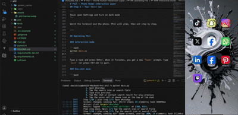

<p align="center">
  
</p>

<p align="center">
  <b>Video calling on WhatsApp</b><br>
  
</p>

# Phil — Phone Human Interaction Layer

**Phil is an AI agent that operates your Android phone from your computer.** You type a goal in the terminal ("turn on dark mode", "message David that I'm on my way"), and Phil reads the screen, decides what to tap, type or swipe, and does it — one step at a time — until the job is done.

Built by **David Aluu**. Released under the [MIT License](LICENSE).

> This is the pure-Python, ADB-based edition of Phil. The original ran as an Android app plus a Node server. Here, a single Python program on your computer does both jobs and talks to the phone over USB or Wi-Fi.

---

## Table of contents

1. [How it works](#how-it-works)
2. [Requirements](#requirements)
3. [Step 1 — Prepare your phone](#step-1--prepare-your-phone)
4. [Step 2 — Install ADB on your computer](#step-2--install-adb-on-your-computer)
5. [Step 3 — Install Phil](#step-3--install-phil)
6. [Step 4 — Configure your API key](#step-4--configure-your-api-key)
7. [Step 5 — Your first run](#step-5--your-first-run)
8. [Operating Phil](#operating-phil)
9. [Writing good tasks](#writing-good-tasks)
10. [Reading the terminal output](#reading-the-terminal-output)
11. [Logging and error reporting](#logging-and-error-reporting)
12. [All settings](#all-settings)
13. [Safety and privacy](#safety-and-privacy)
14. [Troubleshooting](#troubleshooting)
15. [Limitations and differences from the Android app](#limitations-and-differences-from-the-android-app)
16. [Under the hood](#under-the-hood)
17. [Development and tests](#development-and-tests)
18. [License](#license)

---

## How it works

```
 you type a task
       │
       ▼
 ┌───────────┐   goal    ┌────────────┐
 │  main.py  │ ────────► │  agent.py  │  ◄── the loop
 └───────────┘           └─────┬──────┘
                               │ 1. plan   (model: break the goal into steps)
                               │ 2. look   (read + prune + diff the screen)
                               │ 3. decide (model: pick ONE next action)
                               │ 4. act    (tap / type / scroll / key)
                               │ 5. wait   (let animations finish) → back to 2
              ┌────────────────┼─────────────────┐
              ▼                ▼                 ▼
        phil/screen.py    phil/model.py     phil/adb.py
        prune, hash,      any OpenAI-       uiautomator2 (fast)
        diff the UI       compatible API    or plain ADB (fallback)
```

1. **Plan.** The model turns your goal into at most 10 atomic steps.
2. **Look.** Phil reads the phone's accessibility tree, strips the noise (status bar, keyboard keys, decorative images, empty layouts), and fingerprints it with an MD5 hash.
3. **Send only what changed.** The first step (or a new app, or a big screen change) sends the full tree. Later steps send just an ADDED / REMOVED / CHANGED diff, which keeps requests small and fast.
4. **Decide.** The model returns one JSON action, such as `{"action": "click", "target": "com.whatsapp:id/send"}`.
5. **Act.** Phil performs it on the phone, waits for the screen to settle, and repeats until the model says it is done, gets stuck, or the step limit is reached.

---

## Requirements

| What | Details |
|------|---------|
| Computer | Windows, macOS or Linux |
| Python | 3.10 or newer (`python --version`) |
| ADB | Android platform-tools (installed in Step 2) |
| Phone | Android with USB debugging. Android 11+ recommended |
| Cable or Wi-Fi | USB cable, or Wi-Fi on the same network for wireless debugging |
| API access | A key for any OpenAI-compatible API (OpenAI, a local server such as Ollama, etc.) |

---

## Step 1 — Prepare your phone

1. Open **Settings → About phone** and tap **Build number** seven times to unlock *Developer options*.
2. Open **Settings → System → Developer options** and turn on **USB debugging**.
3. **Xiaomi / Redmi / POCO (MIUI, HyperOS) only:** also turn on **USB debugging (Security settings)**. Without it, taps and typing are blocked.
4. Plug the phone into your computer. When the *Allow USB debugging?* prompt appears, tick **Always allow** and tap **Allow**.

### Optional: wireless debugging (Android 11+)

1. In Developer options, turn on **Wireless debugging** and tap it to open its page.
2. Tap **Pair device with pairing code**. On your computer run `adb pair <ip>:<pairing-port>` and enter the code.
3. Run `adb connect <ip>:<port>` using the address shown on the main Wireless debugging page.
4. Set `DEVICE_SERIAL=<ip>:<port>` in `.env` if more than one device is connected.

---

## Step 2 — Install ADB on your computer

| System | Command |
|--------|---------|
| **Windows** | Download *SDK Platform-Tools* from [developer.android.com/tools/releases/platform-tools](https://developer.android.com/tools/releases/platform-tools), unzip it, and add that folder to your `PATH` (or set `ADB_PATH` in `.env` to the full path of `adb.exe`) |
| **macOS** | `brew install android-platform-tools` |
| **Linux (Debian/Ubuntu)** | `sudo apt update && sudo apt install adb` |

Check that it works and that your phone appears as `device`:

```bash
adb devices
```

If it shows `unauthorized`, unlock the phone and accept the debugging prompt. If it shows nothing, try another cable or port.

---

## Step 3 — Install Phil

### 3.1 Get the code into VS Code

```bash
git clone <your-repository-url> phil
cd phil
code .        # opens the folder in VS Code
```

In VS Code, open the built-in terminal with **Terminal → New Terminal** (or `` Ctrl+` ``). Every command below is run there, from the project folder.

### 3.2 Create a virtual environment (recommended)

A virtual environment keeps Phil's packages separate from the rest of your system.

| System | Create | Activate |
|--------|--------|----------|
| **Windows (PowerShell)** | `python -m venv .venv` | `.venv\Scripts\Activate.ps1` |
| **Windows (cmd)** | `python -m venv .venv` | `.venv\Scripts\activate.bat` |
| **macOS / Linux** | `python3 -m venv .venv` | `source .venv/bin/activate` |

Your prompt will start with `(.venv)` when it is active. VS Code may offer to use it as the project interpreter; accept.

> **PowerShell blocks the activate script?** Run `Set-ExecutionPolicy -Scope CurrentUser RemoteSigned` once, then try again.

### 3.3 Install every dependency with one command

This is Python's equivalent of `npm install`:

```bash
pip install -r requirements.txt
```

`requirements.txt` lists package **names only, with no version numbers**, so pip fetches the **latest release of each**: `uiautomator2`, `python-dotenv`, `openai`, `rich` and `Pillow`.

To pull newer versions later:

```bash
pip install --upgrade -r requirements.txt
```

> **A note on unpinned versions.** Always installing the newest releases means you get the latest fixes, but a future release could change behaviour and break Phil. If that happens, find the version that last worked (`pip list` shows what you have) and pin just that package, for example `openai==1.2.3`, in `requirements.txt`.

### Install with uv

```bash
uv sync
uv run python main.py
```

---

## Step 4 — Configure your API key

Your key lives in a private `.env` file that is **never committed to git**.

```bash
# macOS / Linux
cp .env.example .env
# Windows (PowerShell)
Copy-Item .env.example .env
```

Open `.env` and replace the placeholder:

```ini
API_KEY=sk-your-real-key
API_BASE_URL=https://api.openai.com/v1
MODEL_NAME=gpt-4o-mini
```

Because the model is just three settings, switching provider or model is a one-line edit — no code changes. Any OpenAI-compatible endpoint works; for a local server, set `API_BASE_URL` to its address (for example `http://localhost:11434/v1`) and put any non-empty text in `API_KEY`.

You can use a stronger model for decisions than for planning:

```ini
PLANNER_MODEL_NAME=gpt-4o-mini
AGENT_MODEL_NAME=gpt-4o
```

If your provider rejects JSON mode, set `JSON_MODE=false`.

---

## Step 5 — Your first run

1. Make sure your phone is unlocked and shows `device` in `adb devices`.
2. Start Phil:

```bash
python main.py
```

On the first run, uiautomator2 installs a small helper app on the phone. That can take a few seconds. Phil then shows a prompt:

```
Task> open Settings and turn on dark mode
```

Watch the terminal and the phone. Phil will plan, then act step by step.

---

## Operating Phil

### Interactive mode

```bash
python main.py
```

Type a task and press Enter. When it finishes, you get a new `Task>` prompt. Type `exit` (or press Ctrl+D) to quit.

### One-shot mode

```bash
python main.py "open Chrome and search for lo-fi music"
```

Runs a single task, then exits. The exit code is `0` on success, so you can script it.

### Stopping a task

Press **Ctrl+C**. Phil stops the run and, in interactive mode, returns to the prompt.

### Shortcuts

After a task completes in interactive mode, save its successful actions with `save <name>`.
Phil refuses to save an incomplete run or any run that typed into a password field. If the
name already exists, Phil asks before replacing it. `list` shows saved shortcuts, and
`run <number>` or `run <name>` replays one. `delete <number>` or `delete <name>` shows
the shortcut name and step count before asking for confirmation; answering anything other
than `y` or `yes` cancels. A successful deletion prints the updated list.

From the command line, use `python main.py --list-shortcuts`, `python main.py --run "dark
mode"`, or `python main.py --delete "dark mode"`. Deletion asks the same confirmation;
pass `--yes` to skip it.

Replay does not call the model while each screen check and action succeeds. Before every
recorded action, Phil reads the current screen and checks how many of that step's recorded
element keys remain present. The minimum matching fraction is `SHORTCUT_OVERLAP` (default
`0.75`). If the screen differs too much or an action fails, Phil warns and continues from
that step with the stored goal and plan using the normal AI loop. Risky-action confirmations
still apply during replay.

Shortcuts are individual JSON files in `SHORTCUTS_DIR` (default `shortcuts/`), which is
git-ignored. Each file stores its name, goal, plan, creation time, and action steps with
screen keys. Phil does not add the device serial or API key, but goals, targets, and typed
text can contain personal details. **Typed text is included in the action data as plain
text**, so keep shortcut files private. A hand-written format example is in
[`examples/shortcuts/`](examples/shortcuts/).

### Command-line options

| Option | Meaning |
|--------|---------|
| `-s`, `--serial SERIAL` | Use a specific phone (overrides `DEVICE_SERIAL`) |
| `--max-steps N` | Step limit for each task (overrides `MAX_STEPS`) |
| `-y`, `--yes` | Do **not** ask for confirmation before risky actions |
| `--log-level LEVEL` | `DEBUG`, `INFO`, `WARNING` or `ERROR` |
| `--list-devices` | Show connected phones and exit |
| `--list-shortcuts` | List saved shortcuts and exit |
| `--run NAME` | Replay a saved shortcut |
| `--version` | Print the version |

### Exit codes

`0` success · `1` task failed or stuck · `2` configuration error · `3` phone or ADB error · `130` interrupted.

### Confirmations

By default (`CONFIRM_RISKY=true`) Phil asks before it does something hard to undo:

```
! This looks like a 'send' control and may be hard to undo.
  Phil wants to run: click target='com.whatsapp:id/send'
  Allow this? [y/N]
```

It also asks whenever the model itself returns a `confirm` action before a final, irreversible step. Anything other than `y` or `yes` counts as **no**, and the run stops. Once you approve one of the model's own `confirm` questions, Phil stops asking about risky buttons for the rest of that task (approving a single risky button does not do this). Use `--yes` or `CONFIRM_RISKY=false` for fully hands-off runs.

---

## Writing good tasks

Be specific, name the app, and say what "done" looks like.

| Instead of | Try |
|------------|-----|
| "Do something with WhatsApp" | "Open WhatsApp and send David the message: I'm on my way" |
| "Fix my settings" | "Open Settings and turn on dark mode" |
| "Find a video" | "Open YouTube, search for lo-fi music, and play the first result" |

Tips:

- One goal per task. Chain goals by running tasks one after another.
- Include exact text you want typed, in the task itself.
- Phil can only use what is on screen. Make sure the app is installed and you are signed in.
- For anything involving money or messages to other people, leave confirmations on.

---

## Reading the terminal output

```
20:41:02 INFO     Goal: turn on dark mode in Settings
20:41:05 INFO     Plan:
                    1. Open Settings
                    2. Scroll down and tap Display
                    3. Find the Dark mode toggle and turn it on
20:41:05 INFO     Step 1/30 | plan step 1/3: Open Settings
20:41:06 INFO     Screen: changed; sending full (first step); 24 elements; hash 3fa91c2e
20:41:08 INFO     Action: launch_app package=com.android.settings  (Open Settings app)
20:41:08 INFO     Result: Launched com.android.settings.
20:41:11 INFO     Plan step done. Next: 2/3 Scroll down and tap Display
```

| Line | Meaning |
|------|---------|
| `Step n/N` | Current step out of the step limit, and which plan step you are on |
| `Screen:` | Whether the screen changed since the last action (from the MD5 hash), whether Phil sent the **full** tree or only a **diff**, why, the overlap with the previous screen, the element count and a short hash |
| `Action:` | What the model chose, with its short reason |
| `Result:` | What happened on the phone; `FAILED` results are shown as warnings |
| `[completed]` etc. | Final status: `completed`, `stuck`, `failed`, `max_steps` or `aborted` |

---

## Logging and error reporting

Everything Phil does is logged to the terminal. Set the detail level with `LOG_LEVEL` in `.env` or `--log-level` on the command line:

| Level | Shows |
|-------|-------|
| `ERROR` | Only failures |
| `WARNING` | Failures plus recoverable problems (a failed tap, backend fallback, an unusable plan) |
| `INFO` *(default)* | The story above: plan, steps, screen decisions, actions, results |
| `DEBUG` | Everything, including each ADB command, the model name, a truncated model reply and full tracebacks |

To keep a permanent record, set `LOG_FILE=phil.log`. The file rotates automatically (about 1 MB, 3 backups) and is ignored by git.

**What errors look like.** Phil reports problems in plain language with a hint on how to fix them:

- **Phone/ADB:** ADB not found · no phone detected · several phones connected · device `unauthorized` · `uiautomator dump` failed · uiautomator2 helper could not start (Phil falls back to plain ADB and says so)
- **Model/API:** rejected API key · wrong model name or endpoint · rate limited · timeout · cannot reach the API · reply was not valid JSON
- **Actions:** element not found · invalid action returned by the model · app not installed · text the fallback cannot type

Transient problems are retried. After four failures in a row Phil stops with `failed` instead of looping forever.

**Secrets:** your API key is automatically replaced with `***` in all logs, and text sent through plain-ADB typing is never logged. See [Safety and privacy](#safety-and-privacy) for what else can appear in logs.

---

## Run logs and HTML reports

Every task is recorded as one private JSON file in `RECORDS_DIR` (default
`records/`). Generated reports go in `REPORTS_DIR` (default `reports/`). Both
folders are git-ignored. Runs older than `RETENTION_DAYS` (default `7`) are
deleted automatically; set `"keep": true` in a run's JSON to preserve it.
Password text is never recorded. `HIDE_PRIVATE_TEXT=true` also hides typed text
and on-screen text in new records.

In interactive mode, type `print log` and choose 1–6 for the requested time
frame. The same choices are available from the command line:

```bash
python main.py --print-log 1
python main.py --print-log 6 --report-output my-reports --no-open
python main.py --examples-report
```

The generated HTML report is standalone: it needs no internet connection,
external fonts or libraries, and can be saved, printed or opened directly.
Use `HIDE_PRIVATE_TEXT=true` before sharing. Records and reports can contain
on-screen text, goals and typed text. Delete them by hand with the normal
file manager or `rm records/*.json reports/*.html`; examples never use or
delete your real runs.

Preview the harmless illustrative report with `python main.py --examples-report`.
The format and fields are explained in
[`examples/runs/README.md`](examples/runs/README.md).

---

## All settings

Set these in `.env` (see `.env.example`). Real environment variables override `.env`.

| Setting | Default | Meaning |
|---------|---------|---------|
| `API_KEY` | *(required)* | Your API key |
| `API_BASE_URL` | `https://api.openai.com/v1` | Any OpenAI-compatible endpoint |
| `MODEL_NAME` | `gpt-4o-mini` | Model for everything |
| `PLANNER_MODEL_NAME` | *(= MODEL_NAME)* | Model used to plan |
| `AGENT_MODEL_NAME` | *(= MODEL_NAME)* | Model used to pick each action |
| `JSON_MODE` | `true` | Ask for JSON-only replies |
| `TEMPERATURE` | *(provider default)* | Only sent if set |
| `REQUEST_TIMEOUT` | `60` | Seconds to wait for the API |
| `MAX_RETRIES` | `2` | Automatic API retries |
| `DEVICE_SERIAL` | *(auto)* | Which phone, if several are connected |
| `ADB_PATH` | `adb` | Path to the adb executable |
| `USE_UIAUTOMATOR2` | `true` | Fast reader; `false` forces plain ADB |
| `IGNORED_PACKAGES` | `com.android.systemui` | Packages hidden from the model; `none` shows all |
| `MAX_STEPS` | `30` | Step limit per task |
| `STABILIZE_DELAY` | `1.0` | Seconds to wait after an action (0.7–1.5 works well) |
| `SHORTCUTS_DIR` | `shortcuts` | Folder where shortcut JSON files are saved |
| `SHORTCUT_OVERLAP` | `0.75` | Minimum matching screen-key fraction for replay (0–1) |
| `CONFIRM_RISKY` | `true` | Ask before risky actions |
| `ALWAYS_SEND_FULL_TREE` | `false` | Send the whole tree every step (more tokens, easier for weaker models) |
| `OVERLAP_THRESHOLD` | `0.4` | Below this share of matching elements, a screen counts as new |
| `STUCK_THRESHOLD` | `4` | Repeats with no screen change before giving up |
| `LOG_LEVEL` | `INFO` | `DEBUG`, `INFO`, `WARNING`, `ERROR` |
| `LOG_FILE` | *(none)* | Optional log file path |
| `RECORDS_DIR` | `records` | Private run-record JSON folder |
| `REPORTS_DIR` | `reports` | Generated HTML report folder |
| `RUN_SUMMARY` | `failed` | `failed`, `every`, or `never` for AI run summaries |
| `SUMMARY_MODEL_NAME` | *(= MODEL_NAME)* | Cheaper model for AI summaries |
| `HIDE_PRIVATE_TEXT` | `false` | Hide typed and on-screen text in new records |
| `RETENTION_DAYS` | `7` | Automatically delete older unkept run records |
| `TIME_FORMAT` | `24` | Report clock format: `24` or `12` |
| `REPORT_OUTPUT_DIR` | *(reports folder)* | Optional report destination override |
| `VISION_ENABLED` | `false` | Enable optional screenshot input; otherwise screenshots remain off |
| `VISION_MODEL_NAME` | *(= AGENT_MODEL_NAME, then MODEL_NAME)* | Model used for calls containing an image |
| `VISION_MAX_SIZE` | `1024` | Maximum screenshot side in pixels (256–2048) |
| `VISION_JPEG_QUALITY` | `70` | JPEG quality (30–95) |
| `VISION_MIN_ELEMENTS` | `3` | Request a screenshot when the pruned tree has fewer elements |
| `VISION_FAILURE_STREAK` | `2` | Request a screenshot after consecutive failed/repeated actions |
| `VISION_MAX_PER_RUN` | `3` | Hard screenshot cap per task (0–20) |
| `VISION_VERIFY_DONE` | `false` | Ask once for screenshot-based verification before accepting “done” |
| `VISION_SAVE_DIR` | *(none)* | Optional directory for prepared screenshots; empty means never save |

## Screenshots (optional)

Phil remains text-first: accessibility-tree actions and UI diffs stay the normal path.
When `VISION_ENABLED=true`, it can request a screenshot when the pruned tree has fewer
than `VISION_MIN_ELEMENTS` elements, after `VISION_FAILURE_STREAK` consecutive failed
or repeated/no-effect actions, or when the model explicitly returns `take_screenshot`.
`VISION_VERIFY_DONE=true` optionally asks the model once to verify a “done” response
after a device action. `VISION_MAX_PER_RUN` caps captures, including blank screens.
Screenshots are resized and sent only with that one model request; this can add API
cost and latency, especially when the provider uses a more expensive vision model.

**Privacy warning:** screenshots are sent to your configured API provider and may show
sensitive content that text masking does not hide. Phil never saves images unless
`VISION_SAVE_DIR` is explicitly set. Keep vision off on sensitive screens and use a
provider you trust.

---

## Safety and privacy

Phil taps, types and swipes on a **real phone** using real accounts. Treat it accordingly.

- **Your screen contents leave your computer.** Each step sends the visible UI text (messages, names, contacts, balances — whatever is on screen) to the API provider you configured. Use a provider you trust, or a local model, and do not run Phil while sensitive screens are open.
- **Passwords are masked.** Text in password fields is replaced with bullets before it is sent. Typing a password *into* a field still sends it to the model as part of the action, so avoid asking Phil to type secrets.
- **Keep confirmations on** for sending messages, payments, deletions and posting.
- **Prompt injection is real.** A message or web page could contain text that tries to give Phil new orders. The agent prompt tells the model to treat on-screen text as content, never instructions, but no model is perfect. Watch the terminal.
- **Logs may contain sensitive text.** At `INFO`, logs include the goal, targets, and the first 30 characters of anything Phil types. At `DEBUG` they also include model replies. Treat `LOG_FILE` accordingly, and never share logs without reading them first.
- **Run records and reports are private.** They contain on-screen text and goals by default and are ignored by git. Set `HIDE_PRIVATE_TEXT=true` to hide typed text and on-screen text in future records. Check reports before sharing.
- **Your API key** lives only in `.env`, which is git-ignored. Never paste it into code or screenshots.
- Phil is provided **as is**, with no warranty (see the license). You are responsible for what it does on your device.

---

## Troubleshooting

| Symptom | Likely cause and fix |
|---------|----------------------|
| `Configuration error: API_KEY is missing` | You have not created `.env`, or it still has the placeholder. See [Step 4](#step-4--configure-your-api-key). |
| `ADB executable 'adb' was not found` | ADB is not installed or not on `PATH`. See [Step 2](#step-2--install-adb-on-your-computer), or set `ADB_PATH`. |
| `No phone detected` | Cable or port problem, USB debugging off, or the phone is locked. Run `adb devices`. |
| Device shows `unauthorized` | Unlock the phone and accept the *Allow USB debugging* prompt. If it never appears: `adb kill-server`, unplug, replug. |
| `Several phones are connected` | Use `--serial`, `DEVICE_SERIAL`, or run `python main.py --list-devices` to find the serial. |
| Taps or typing do nothing (Xiaomi/Redmi/POCO) | Enable **USB debugging (Security settings)** in Developer options. |
| Warning: `Could not start uiautomator2 … falling back to plain ADB` | Phil still works, just slower. Check the phone is unlocked, then retry; allow the helper app to install. |
| `The plain-ADB fallback can only type ASCII text` | Plain ADB cannot type accents, emoji or new lines. Fix uiautomator2 (above) for full text support. |
| `The API rejected your key` | Wrong or expired key, or the key belongs to a different provider than `API_BASE_URL`. |
| `Model or endpoint not found` | Check `MODEL_NAME` and `API_BASE_URL` for typos. |
| `The API rejected the request … JSON mode` | Set `JSON_MODE=false` in `.env`. |
| `rate limit` / timeouts | Wait and retry, raise `REQUEST_TIMEOUT`, or choose a faster model. |
| `The model returned an invalid action` repeatedly | Use a stronger `AGENT_MODEL_NAME`, or set `ALWAYS_SEND_FULL_TREE=true`. |
| `Element not found: '…'` | The model guessed an id that is not on screen. Usually self-corrects; if not, try a stronger model or run with `--log-level DEBUG`. |
| Run ends `stuck` | The same action repeated with no change. Rephrase the task, make it more specific, or complete the blocking step by hand and rerun. |
| Run ends `max_steps` | The task needs more steps. Raise `MAX_STEPS`, or split the task. |
| Phil cannot see the notification shade | By default system UI is hidden from the model. Set `IGNORED_PACKAGES=none` (this also shows the status bar). |
| After an update something broke | Versions are unpinned. Run `pip list`, then pin the package that changed. |
| `pip` says *externally-managed-environment* | Create and activate a virtual environment first ([Step 3.2](#32-create-a-virtual-environment-recommended)). |

For anything else, run `python main.py --log-level DEBUG` and read the last lines before the failure.

---

## Limitations and differences from the Android app

- **Slower reads.** The original Android service sensed changes instantly. Phil polls: uiautomator2 is fast; plain ADB `uiautomator dump` takes 1–3 seconds per step.
- **No reactive events.** Phil only knows the screen changed because it looks again after waiting `STABILIZE_DELAY`.
- **System UI is hidden by default**, including the notification shade and system dialogs, and animating overlays can be missed.
- **Keyboard:** typing uses uiautomator2's input method, so the on-screen keyboard is usually not visible. Use the `enter` action to submit. The soft keyboard's action keys (Enter/Search/Go/Done) are kept in the tree when a keyboard is visible.
- **Taps are coordinate taps.** The Android service tried a virtual click first and fell back to a coordinate gesture; over ADB, Phil always taps the centre of the element (climbing to the nearest clickable ancestor for plain text).
- **Fewer actions.** `copy`, `cut`, `set_selection` and `clear_focus` need Accessibility-service internals and are not available. `expand`, `collapse`, `focus` and `dismiss` are emulated with taps and swipes.
- **The model sees only changes after step one.** Unchanged elements are not repeated, so weaker models can lose track of IDs. Set `ALWAYS_SEND_FULL_TREE=true` if that happens.
- **No chat server.** The original `/chat` and `/start` endpoints (notification chat, goal extraction) are replaced by typing the task in the terminal.
- Some apps block accessibility reading (banking apps, secure screens) and appear blank to Phil.

---

## Under the hood

```
phil/
├── README.md
├── LICENSE
├── .env.example          # fake values, safe to share
├── .gitignore            # keeps your real .env off GitHub
├── requirements.txt      # runtime dependencies (unpinned)
├── requirements-dev.txt  # + pytest
├── pytest.ini
├── ruff.toml             # optional lint settings
├── main.py               # command-line entry point
├── phil/
│   ├── __init__.py
│   ├── config.py         # loads .env into a typed Settings object
│   ├── log.py            # terminal + file logging, secret redaction
│   ├── adb.py            # the phone: uiautomator2 first, plain ADB fallback
│   ├── screen.py         # parse, prune, hash, diff, overlap, target lookup
│   ├── vision.py         # optional screenshot preparation and coordinate scaling
│   ├── actions.py        # action vocabulary, validation, execution
│   ├── prompts.py        # planner and agent prompts, app hints
│   ├── model.py          # swappable OpenAI-compatible model call
│   └── agent.py          # the loop
└── tests/
```

### The screen pipeline (`phil/screen.py`)

**Pruning rules**

- Drop anything with no visible area, and anything from ignored packages (system UI by default).
- A leaf that is not clickable, focusable or scrollable is deleted — *unless it carries text or a content description*, so the model can still read labels and messages. (This is one deliberate relaxation of the original rule.)
- Empty layout containers are deleted; plain wrapper layouts are flattened.
- Images are deleted unless clickable.
- All keyboard keys are removed except the action keys (Enter, Search, Go, Done).
- Password text is masked.

**Hashing.** The pruned tree is rendered to text and hashed with MD5. A matching hash means the last action changed nothing.

**Full tree vs. diff.** Elements are identified by key: resource id, else content description, else class and text, else class and position. Duplicates are numbered `#2`, `#3`. Then:

| Situation | What the model receives |
|-----------|-------------------------|
| First step | Full tree |
| Foreground app changed | Full tree |
| Fewer than 40% of the previous elements remain (the **overlap** rule) | Full tree |
| Nothing visibly changed | Full tree, "for safety" |
| Same screen, some changes | `ADDED` / `REMOVED` / `CHANGED` diff only |

Example diff:

```
UI Changes since last action (42 elements unchanged):
ADDED elements:
  + [id:com.whatsapp:id/send] [ImageButton] "" id:com.whatsapp:id/send (clickable)
CHANGED elements:
  ~ [id:com.whatsapp:id/entry] text: "" → "Hello David"
```

### Two backends, one interface (`phil/adb.py`)

`Device` hides the reader behind one interface. uiautomator2 is the default; if it is missing or fails, Phil logs a warning and permanently switches to plain `adb` commands for the session. The two are never used at the same moment.

### App hints (`phil/prompts.py`)

`APP_HINTS` holds short, concrete lessons for specific apps (for example the WhatsApp resource ids). They are appended to both prompts. Add your own there.

---

## Development and tests

```bash
pip install -r requirements-dev.txt
python -m pytest
```

The suite covers pruning, diffing, target resolution, action parsing and execution, config validation, model-reply parsing, the whole agent loop (with a fake phone and a scripted model), and the ADB layer (against a fake `adb` executable). No phone or API key is needed to run it.

Contributions are welcome. Please keep the existing style: type hints, docstrings, small focused functions, and a test for every behaviour you add or change.

---

## License

Phil is released under the [MIT License](LICENSE).

Copyright © 2026 David Aluu
